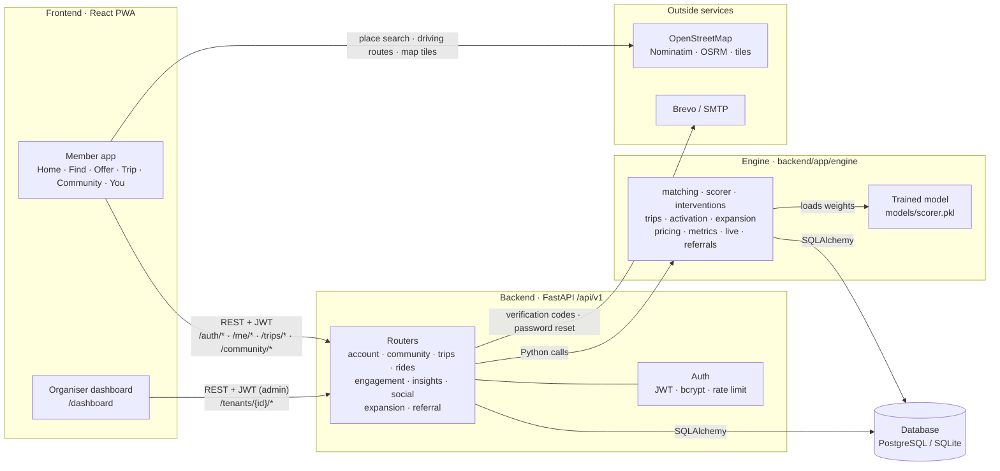
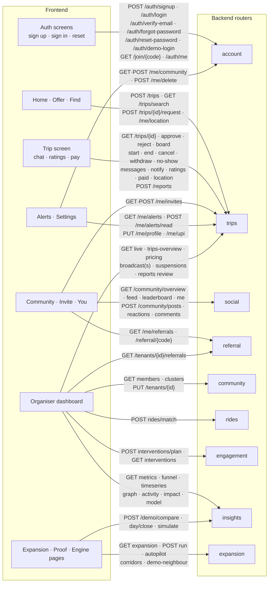
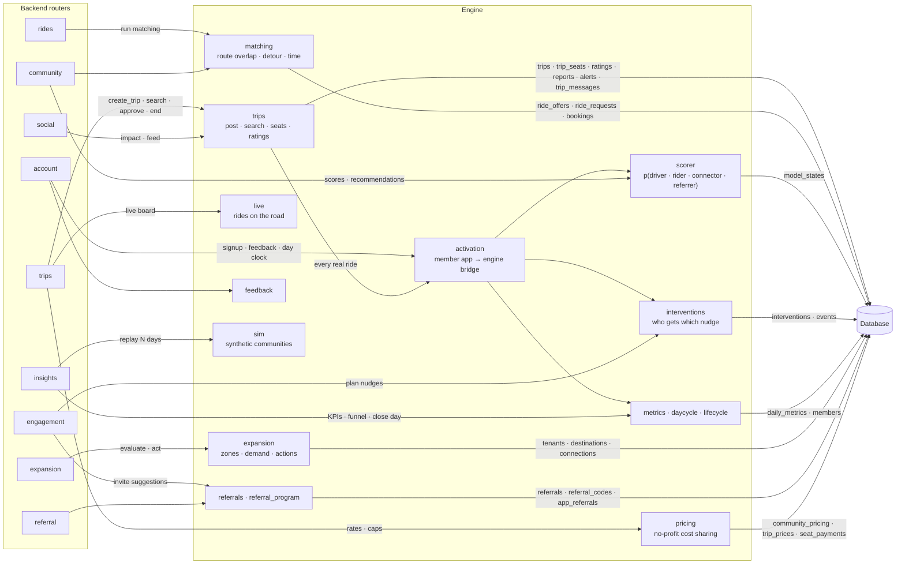
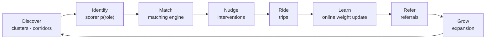

<div align="center">

# 🚗 FellaRide

**Community carpooling that activates itself.**
Drivers post their real route, riders along it ask for a seat, and an ML engine
finds, matches and nudges the right people until a community is riding together.

<sub>Manipal Hackathon · M3 project · qualified for the top 10</sub>

### 👉 [**Open the live app: fellaride-web.onrender.com**](https://fellaride-web.onrender.com) 👈

[Organiser dashboard](https://fellaride-web.onrender.com/dashboard) ·
[API](https://fellaride-api.onrender.com) ·
[API docs](https://fellaride-api.onrender.com/docs)

<sub>Hosted on Render's free plan, so the first load after a quiet spell can take about a minute.</sub>

</div>

---

## At a glance

| | |
|---|---|
| **Project** | FellaRide: Community Activation Engine for carpooling |
| **Hackathon** | Manipal Hackathon 2026 · M3 project · top 10 |
| **Problem statement** | PS Variant 1, *Community in Motion* |
| **Live app** | **https://fellaride-web.onrender.com** |
| **Try it** | Open the app → **Try the demo community** → tap any person (no sign-up) |
| **Sign up yourself** | Use the join code **`DEMO2026`** to land in the demo community with its rides |
| **Demo community** | *MIT Manipal* and its neighbour *Manipal Tech Park* (both synthetic) |

**Contents:** [Problem](#-the-problem) · [Solution](#-our-solution) · [Features](#-features) · [Architecture](#-architecture) · [Tech stack](#-tech-stack) · [Run it](#-run-it-locally) · [API](#-api-reference)

---

## 🧩 The problem

Communities like colleges, companies, tech parks and housing societies are full of people making the same commute in separate cars.
Carpool apps exist, but a new community starts **empty**: no drivers means no riders, and no riders means no drivers.
The PS asks for a system that brings a community to life. It should find likely drivers, riders and connectors, match them,
nudge the right person at the right time, learn from what happens, and grow the network.

## 💡 Our solution

FellaRide pairs a **member app** with an **activation engine**, and every real ride in the app feeds that engine:

**Discover → Identify → Match → Nudge → Ride → Learn → Refer → Grow**

> **Result:** we compared the smart engine with random nudges on identical synthetic communities over 40 days
> (`POST /api/v1/demo/compare`). The engine produced **1.9× more active users, 3.7× more completed rides,
> 1.5× more registrations and a 1.7× higher match rate**.

---

## ✨ Features

### 📱 Member app (riders and drivers)

- **Driving or riding, every day:** Home asks *I'm driving* or *I need a ride* each time. It's never fixed to the account.
- **Offer a ride:** from, to, time, seats and car. Pick from up to **3 real driving routes** on the map and confirm one.
- **Nearby alerts:** posting a ride alerts everyone within **2.5 km of the route**.
- **Find a ride:** every ride whose route passes your pickup *and then* your drop. You see the driver's name, gender and rating, the car and the seats left. Filter by women or men drivers, sort by closest, soonest or top rated, and **ask several drivers at once**.
- **Seat requests:** the driver approves or declines. A full car auto-declines the rest, and each person has one active ride at a time.
- **Who's in the car:** a live card showing the driver, each rider's stop, who's on board and the free seats.
- **Boarding code:** everyone approved shares one 4-digit code to check before getting in. The driver marks **who got in**.
- **Group chat, Call and one-tap driver updates** ("Running 5 min late"). Phone numbers are shown only to people in the same ride.
- **Cost sharing:** a suggested per-km contribution, paid by UPI or cash. A **no-profit cap** means riders never pay more than the trip costs.
- **Ratings:** everyone rates everyone after the ride, using a recency-weighted average of the last 20 ratings. Penalties are automatic: leaving early without a rider, or cancelling after approving someone.
- **Reports:** multiple-choice reasons, filed under the most serious category (Safety > Money > Reliability > Behaviour > Other).
- **Alerts:** an in-app banner, an Alerts tab, and **phone notifications** through a service worker.
- **Community:** a weekly challenge, a board with posts, reactions and replies, a leaderboard, and your impact (km, CO₂, people met) and badges.
- **Referrals:** a personal code and link. **+10 points** when a friend joins and **+40** on their first ride, with Bronze, Silver and Gold tiers.
- **Switch communities** with a join code. **Forgot password** emails a link and a 6-digit code. **Delete my account** is self-serve.
- An **installable PWA** with a phone-first layout and dark mode.

### 🛠️ Organiser dashboard (`/dashboard`)

- **Overview:** today's shared rides, joins, match and repeat rates, 8 KPIs with 7-day trends, **Needs your attention**, the funnel and a live activity feed.
- **Live map:** members on real streets. Play the day to watch the community grow, with rides drawn as threads and invites as dashed lines.
- **Members:** the roster by stage, with search, filters and CSV export. Each profile shows likelihood scores and best ride partners.
- **Impact:** CO₂ saved, trees' worth, km not driven, and money saved by day and by route, plus a **downloadable PDF report**.
- **Live rides:** cars moving along real roads right now. The demo community replays recent rides, marked *Simulated*.
- **Rides & safety:** ratings, penalties, the reports queue, and **pausing accounts**.
- **Announcements:** notify everyone, drivers, riders or inactive members, with read rates.
- **Pricing:** set the community's cost-sharing rates.
- **Engine:** run the day, see today's nudges and why, and see what predicts a yes.
- **Expansion:** where to grow next, neighbouring communities to connect, actions taken and what worked. On demo communities, **Autopilot** runs it day after day.
- **Proof:** the smart engine vs random nudges, side by side.

### 🧠 Activation engine (ML)

| Part | What it does |
|---|---|
| **Community intelligence** | Builds member features and finds **corridors**: same ~1.5 km home cell, same destination, same 30-minute window. |
| **Propensity scorer** | Logistic regression for 4 roles (**driver, rider, connector, referrer**). Trained offline, then **updated online** after every outcome. |
| **Matching** | 0.40·route overlap + 0.25·(1 − detour/3 km) + 0.25·(1 − Δt/30 min) + 0.10·preference fit. Poorly rated partners rank lower. |
| **Interventions** | Priority = p(role) × corridor value × (1 − fatigue), with a daily budget and a cooldown. **Connectors go first** on days 0–4. 15% of nudges are exploration. |
| **Network expansion** | Zones with supply, demand and a 7-day forecast. Each bottleneck maps to a growth action, and a Beta posterior picks the next one. |
| **Referrals** | Invite suggestions ranked by predicted rider propensity, with a bonus for hot corridors. |
| **Metrics** | Active users, rides, match, completion and repeat rates, connectivity, nudge response and referral conversion. |
| **Simulator** | Replays days on synthetic communities, for the demo, training and the Proof comparison. |
| **Activation bridge** | Turns every member-app action into engine data, so real rides move the funnel and train the model. |

### 🔒 Platform and security

- JWT auth, bcrypt passwords, and rate-limited sign-in and sign-up.
- Strict community scoping: another community's data returns 404, and only organisers can run the engine.
- Every input is validated with pydantic. Errors are plain sentences and never include stack traces.
- Docker Compose for local runs and a Render Blueprint for hosting ([DEPLOY.md](DEPLOY.md)).

---

## 🏗️ Architecture

### 1. The big picture



### 2. Frontend → Backend: which screen calls which API



### 3. Backend → Engine → Database



### 4. The engine loop



---

## 🧰 Tech stack

| Layer | Technology |
|---|---|
| **Frontend** | React 18, TypeScript, Vite 5, TanStack Query, React Router, Leaflet, Framer Motion · installable PWA with a service worker |
| **Backend** | Python, FastAPI, SQLAlchemy 2, Pydantic 2, Uvicorn · JWT (PyJWT) and bcrypt |
| **Engine / ML** | scikit-learn and NumPy (offline training) · pure-Python online logistic regression, matching and expansion |
| **Database** | PostgreSQL (Supabase) in production · SQLite for local dev and tests |
| **Maps** | OpenStreetMap tiles, Nominatim (place search), OSRM (driving routes) |
| **Email** | Brevo (HTTPS API), with SMTP as a fallback |
| **Hosting** | Render (two Docker services via `render.yaml`) · Docker Compose locally · nginx serves the web build |
| **Testing** | pytest (API and engine) · Playwright (end-to-end, cross-browser smoke tests) |

---

## 🚀 Run it locally

**With Docker (everything):**
```bash
cp .env.example .env            # fill in the secrets
docker compose --profile localdb up --build
# Web: http://localhost:3000 · API docs: http://localhost:8000/docs
```

**Without Docker:**
```bash
# backend (Python 3.12+; uses SQLite when FELLARIDE_DATABASE_URL is unset)
cd backend
python -m venv .venv && .venv/bin/pip install -r requirements-dev.txt   # Windows: .venv\Scripts\pip
.venv/bin/uvicorn app.main:app --reload                                # http://localhost:8000

# frontend
cd frontend
cp .env.example .env.local && npm ci && npm run dev                    # http://localhost:5173
```
A fresh database seeds the synthetic **MIT Manipal** community (join code `DEMO2026`). The local organiser login is
`admin@demo.fellaride.app` with the password from `FELLARIDE_DEMO_ADMIN_PASSWORD` (default `fellaride-demo-admin`).

**Tests:**
```bash
cd backend  && .venv/bin/python -m pytest -q     # API, engine, trips, matching, simulation
cd frontend && npm run build                     # type check and production build
cd frontend && npx playwright test               # end-to-end (starts its own API and web app)
```

**Repo layout:**
```
backend/app/api/        HTTP routers, one file per area
backend/app/engine/     matching, scoring, nudges, trips, expansion, pricing, metrics
backend/app/sim/        synthetic communities and behaviour simulation
backend/ml/             offline training of the propensity model → backend/models/
frontend/src/member/    member app screens
frontend/src/dashboard/ organiser dashboard
frontend/src/api/       typed API client and React Query hooks
frontend/e2e/           Playwright tests
```

---

## 📡 API reference

About 120 REST endpoints under **`/api/v1`**, grouped into 9 routers. You can try them all in the interactive docs at
**[fellaride-api.onrender.com/docs](https://fellaride-api.onrender.com/docs)**.

| Router | What it covers | Key endpoints |
|---|---|---|
| `account` | Sign-up, sign-in, email verification, password reset, switching communities | `POST /auth/signup` · `POST /auth/login` · `GET /auth/me` |
| `trips` | The member app: post and find rides, seats, chat, ratings, reports, alerts, and organiser moderation | `POST /trips` · `GET /trips/search` · `POST /trips/{id}/request` |
| `community` | Communities, members, likelihood scores, corridors | `POST /tenants` · `GET /tenants/{id}/members` |
| `rides` | Engine-side offers, requests and matching | `POST /tenants/{id}/rides/match` |
| `engagement` | Nudges and invites | `POST /tenants/{id}/interventions/plan` |
| `insights` | KPIs, funnel, growth graph, impact, model, simulation | `GET /tenants/{id}/metrics` · `POST /demo/compare` |
| `social` | The community board, leaderboard, your impact | `GET /community/feed` · `GET /community/impact` |
| `expansion` | The Network Expansion Engine | `POST /tenants/{id}/expansion/run` |
| `referral` | Referral codes, points and tiers | `GET /me/referrals` |

<details>
<summary><b>Full endpoint list</b> (click to expand) · 🔓 public · 👤 signed-in member · 🛡️ organiser</summary>

#### account
| Method | Path | Access | What it does |
|---|---|---|---|
| POST | `/auth/signup` | 🔓 | Create an account (name, gender, email, mobile, password, optional join code) |
| POST | `/auth/register` | 🔓 | Join a community with a join code and set up a commute |
| POST | `/auth/login` | 🔓 | Sign in with email or mobile and password |
| POST | `/auth/verify-email/send` | 👤 | Email a new 6-digit code |
| POST | `/auth/verify-email` | 👤 | Confirm the email with the code |
| POST | `/auth/forgot-password` | 🔓 | Email a reset link and code |
| POST | `/auth/reset-password` | 🔓 | Set a new password and sign in |
| POST | `/auth/demo-login` | 🔓 | Demo only: sign in as a synthetic member |
| GET | `/tenants/{tenant_id}/demo-accounts` | 🔓 | Demo only: members you can sign in as |
| GET | `/auth/me` | 👤 | Who is signed in |
| GET / POST | `/me/community` | 👤 | Your community, or move to another one |
| POST | `/me/delete` | 👤 | Delete your account |
| GET | `/tenants/{tenant_id}/me/notifications` | 👤 | Your messages |
| POST | `/tenants/{tenant_id}/me/notifications/read` | 👤 | Mark messages as read |
| GET | `/tenants/{tenant_id}/me/feedback-due` | 👤 | Completed rides you haven't rated |
| POST | `/tenants/{tenant_id}/rides/bookings/{booking_id}/feedback` | 👤 | Rate a completed engine ride |
| GET | `/join/{join_code}` | 🔓 | Look up a community by join code |

#### trips
| Method | Path | Access | What it does |
|---|---|---|---|
| PUT | `/me/profile` | 👤 | Set name, gender, mobile |
| POST | `/me/location` | 👤 | Your location, for "ride near you" alerts |
| GET | `/me/alerts` · POST `/me/alerts/read` | 👤 | Your notifications, and marking them read |
| GET | `/me/trips` | 👤 | Ride in progress, pending requests, history |
| GET / POST | `/me/invites` | 👤 | List or send email invites |
| PUT | `/me/upi` | 👤 | Your UPI ID for contributions |
| GET | `/report-reasons` | 🔓 | Report reasons by category |
| POST | `/trips` | 👤 | Driver: post a ride |
| GET | `/trips/search` | 👤 | Rider: rides passing near pickup (and drop) |
| GET | `/trips/{trip_id}` | 👤 | One ride, as you may see it |
| POST | `/trips/{trip_id}/request` · `/withdraw` | 👤 | Ask for a seat, or take the request back |
| POST | `/trips/{trip_id}/seats/{seat_id}/approve` · `/reject` | 👤 | Driver: approve or decline a seat |
| POST | `/trips/{trip_id}/seats/{seat_id}/board` · `/no-show` | 👤 | Driver: the rider got in, or wasn't there |
| POST | `/trips/{trip_id}/paid` · `/seats/{seat_id}/received` | 👤 | Contribution paid, and received |
| POST | `/trips/{trip_id}/start` · `/end` · `/cancel` | 👤 | Start, end or cancel the ride |
| POST | `/trips/{trip_id}/location` | 👤 | Share live position on the ride |
| GET / POST | `/trips/{trip_id}/messages` | 👤 | Ride chat |
| POST | `/trips/{trip_id}/notify` | 👤 | Driver: send an update to every rider |
| POST | `/trips/{trip_id}/ratings` | 👤 | Rate someone you travelled with |
| POST | `/reports` | 👤 | Report someone from a ride |
| POST | `/tenants/{tenant_id}/broadcast` · GET `/broadcasts` | 🛡️ | Notify every member, and the history |
| GET / POST | `/tenants/{tenant_id}/suspensions` · DELETE `/{user_id}` | 🛡️ | Pause members, or lift a pause |
| GET / PUT | `/tenants/{tenant_id}/pricing` | 👤 / 🛡️ | Read or change the cost-sharing rates |
| GET | `/tenants/{tenant_id}/live` | 🛡️ | Rides on the road now |
| GET | `/tenants/{tenant_id}/trips-overview` | 🛡️ | Rides, ratings and reports |
| POST | `/tenants/{tenant_id}/reports/{report_id}/review` | 🛡️ | Mark a report reviewed |

#### community
| Method | Path | Access | What it does |
|---|---|---|---|
| POST | `/tenants` · `/tenants/demo` | 🔓 | Create a community (or a synthetic demo one) |
| GET | `/tenants` · `/tenants/{tenant_id}` | 🔓 | List communities, or get one |
| PUT | `/tenants/{tenant_id}` | 🛡️ | Rename the community |
| POST | `/tenants/{tenant_id}/members/import` | 🛡️ | Import members |
| POST | `/tenants/{tenant_id}/members/{member_id}/register` | 🛡️ | Mark an imported member as signed up |
| GET | `/tenants/{tenant_id}/members` | 🛡️ | List members |
| GET | `/tenants/{tenant_id}/members/{member_id}` | 👤 | Profile with likelihood scores |
| GET | `/tenants/{tenant_id}/members/{member_id}/recommendations` | 👤 | Best ride partners |
| GET | `/tenants/{tenant_id}/clusters` | 🛡️ | Commute corridors |

#### rides · engagement
| Method | Path | Access | What it does |
|---|---|---|---|
| POST | `/tenants/{tenant_id}/rides/offers` · `/requests` | 👤 | Offer or request an engine ride |
| POST | `/tenants/{tenant_id}/rides/requests/{request_id}/cancel` | 👤 | Withdraw a request |
| POST | `/tenants/{tenant_id}/rides/match` | 🛡️ | Run the matching engine |
| GET | `/tenants/{tenant_id}/rides` | 👤 | Rides for a day |
| POST | `/tenants/{tenant_id}/rides/offers/{offer_id}/start` · `/finish` | 👤 | Start, or complete or cancel |
| POST | `/tenants/{tenant_id}/interventions/plan` | 🛡️ | Plan today's nudges |
| GET | `/tenants/{tenant_id}/interventions` | 👤 | List nudges (members see their own) |
| POST | `/tenants/{tenant_id}/interventions/{intervention_id}/respond` | 👤 | Answer a nudge |
| GET | `/tenants/{tenant_id}/members/{member_id}/invite-suggestions` | 👤 | Who to invite |
| GET | `/tenants/{tenant_id}/me/referrals` | 👤 | Invites you sent |
| POST | `/tenants/{tenant_id}/referrals` · `/{referral_id}/accept` | 👤 | Send or accept an invite |

#### insights · expansion
| Method | Path | Access | What it does |
|---|---|---|---|
| GET | `/tenants/{tenant_id}/metrics` · `/funnel` · `/timeseries` | 🛡️ | KPIs, funnel, daily snapshots |
| GET | `/tenants/{tenant_id}/graph` · `/activity` · `/impact` · `/model` | 🛡️ | Growth graph, activity, impact, model weights |
| POST | `/tenants/{tenant_id}/day/close` · `/simulate` | 🛡️ | Close the day, or replay N days (synthetic only) |
| POST | `/demo/compare` | 🔓 | Smart engine vs random nudges |
| GET | `/tenants/{tenant_id}/expansion` | 🛡️ | Where to grow and what worked |
| POST | `/tenants/{tenant_id}/expansion/run` · `/autopilot` | 🛡️ | Run one cycle, or several |
| POST | `/tenants/{tenant_id}/expansion/corridors` · `/demo-neighbour` | 🛡️ | Link a corridor, or add a synthetic neighbour |

#### social (`/community`) · referral
| Method | Path | Access | What it does |
|---|---|---|---|
| GET | `/community/impact` | 🔓 | Network-wide impact (welcome page) |
| GET | `/community/overview` · `/feed` · `/leaderboard` · `/me` | 👤 | Numbers, feed, top sharers, your impact |
| POST / DELETE | `/community/posts` · `/posts/{post_id}` | 👤 | Post on the board, or delete a post |
| POST | `/community/posts/{post_id}/reactions` | 👤 | React |
| GET / POST | `/community/posts/{post_id}/comments` | 👤 | Read or write replies |
| GET | `/referral/{code}` | 🔓 | Whose referral code this is |
| GET | `/me/referrals` | 👤 | Your code, friends, points, tier |
| GET | `/tenants/{tenant_id}/referrals` | 🛡️ | Referral overview |
| GET | `/health` (no prefix) | 🔓 | Liveness check |

</details>
