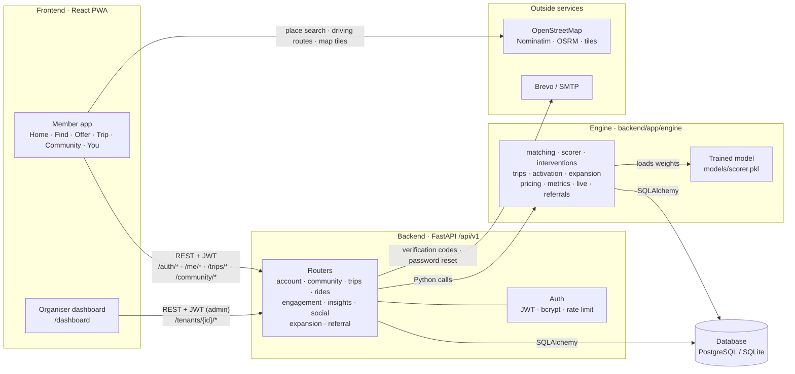
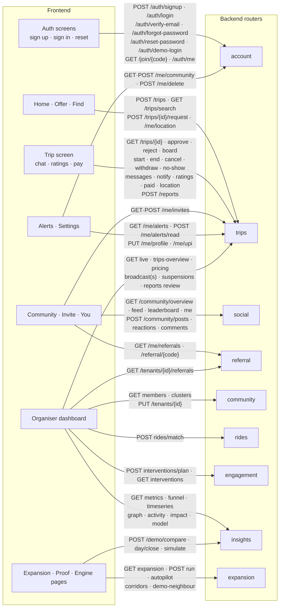
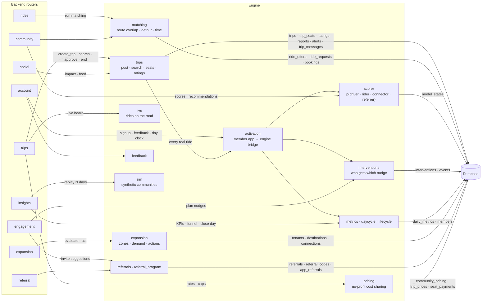
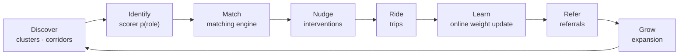

# FellaRide

<sub>Manipal Hackathon · M3 project · qualified for the top 10</sub>

> ### 🚗 Live app: **[fellaride-web.onrender.com](https://fellaride-web.onrender.com)**
> Organiser dashboard: **[/dashboard](https://fellaride-web.onrender.com/dashboard)** · API: **[fellaride-api.onrender.com](https://fellaride-api.onrender.com)** · API docs: **[/docs](https://fellaride-api.onrender.com/docs)**
>
> <sub>It's hosted on Render's free plan, so the first load after a quiet spell can take about a minute.</sub>

**Try it in 30 seconds:** open the app → **Try the demo community** → tap any person. To sign up with your own account,
use the join code **`DEMO2026`** so you land in the demo community with its rides.

FellaRide is community carpooling for campuses and workplaces. Members share rides through a mobile-first app.
An **activation engine** behind it finds who is likely to drive, ride, or invite friends. It nudges them, matches
them, and learns from every ride. Organisers run each community from a dashboard.

- **Frontend**: React 18, Vite, TypeScript, TanStack Query, Leaflet. An installable PWA (`frontend/`).
- **Backend**: FastAPI, SQLAlchemy 2, Pydantic 2, JWT auth (`backend/app/`).
- **Engine**: pure-Python matching, propensity scoring (online-learned), interventions, expansion and pricing (`backend/app/engine/`).
- **Database**: PostgreSQL (Supabase or Docker) in production. SQLite for local dev and tests.

---

## Architecture

### 1. The big picture



### 2. Frontend → Backend: which screen calls which API

Every arrow is an HTTP call from a screen to a router. The token is attached by `frontend/src/api/client.ts`.



### 3. Backend → Engine → Database

Routers stay thin. The logic lives in the engine, and every engine module reads and writes through SQLAlchemy.



### 4. The engine loop



- **Matching score** = 0.40·route overlap + 0.25·(1 − detour/max) + 0.25·(1 − |Δt|/max) + 0.10·preference fit.
- **Scorer**: `p(role) = sigmoid(w·x)`. It starts from `models/scorer.pkl` (trained by `ml/train_scorer.py`), then updates per community after every outcome.
- **Pricing**: riders chip in by distance, and the total can never exceed the driver's trip cost.

---

## API reference

Base path: **`/api/v1`**. Interactive docs: `http://localhost:8000/docs`.
🔓 public · 👤 signed-in member · 🛡️ organiser (admin)

### System
| Method | Path | Access | What it does |
|---|---|---|---|
| GET | `/health` (no prefix) | 🔓 | Liveness and whether the model file is loaded |

### Account and auth (`account`)
| Method | Path | Access | What it does |
|---|---|---|---|
| POST | `/auth/signup` | 🔓 | Create an account (name, gender, email, mobile, password, optional join code) |
| POST | `/auth/register` | 🔓 | Join a community with a join code and set up a commute |
| POST | `/auth/login` | 🔓 | Sign in with email or mobile and password |
| POST | `/auth/verify-email/send` | 👤 | Email a new 6-digit code |
| POST | `/auth/verify-email` | 👤 | Confirm the email with the code |
| POST | `/auth/forgot-password` | 🔓 | Email a reset link and code |
| POST | `/auth/reset-password` | 🔓 | Set a new password and sign in |
| POST | `/auth/demo-login` | 🔓 | Demo only: sign in as a synthetic member |
| GET | `/tenants/{tenant_id}/demo-accounts` | 🔓 | Demo only: members you can sign in as |
| GET | `/auth/me` | 👤 | Who is signed in |
| GET | `/me/community` | 👤 | Your community and the ones you can move to |
| POST | `/me/community` | 👤 | Move to another community |
| POST | `/me/delete` | 👤 | Delete your account |
| GET | `/tenants/{tenant_id}/me/notifications` | 👤 | Your messages |
| POST | `/tenants/{tenant_id}/me/notifications/read` | 👤 | Mark messages as read |
| GET | `/tenants/{tenant_id}/me/feedback-due` | 👤 | Completed rides you haven't rated |
| POST | `/tenants/{tenant_id}/rides/bookings/{booking_id}/feedback` | 👤 | Rate a completed engine ride |
| GET | `/join/{join_code}` | 🔓 | Look up a community by join code |

### Trips: member app (`trips`)
| Method | Path | Access | What it does |
|---|---|---|---|
| PUT | `/me/profile` | 👤 | Set name, gender, mobile |
| POST | `/me/location` | 👤 | Your location, for "ride near you" alerts |
| GET | `/me/alerts` | 👤 | Your notifications |
| POST | `/me/alerts/read` | 👤 | Mark notifications read |
| GET | `/me/trips` | 👤 | Ride in progress, pending requests, history |
| GET / POST | `/me/invites` | 👤 | List or send email invites |
| PUT | `/me/upi` | 👤 | Your UPI ID for contributions |
| GET | `/report-reasons` | 🔓 | Report reasons by category |
| POST | `/trips` | 👤 | Driver: post a ride |
| GET | `/trips/search` | 👤 | Rider: rides passing near pickup (and drop) |
| GET | `/trips/{trip_id}` | 👤 | One ride, as you may see it |
| POST | `/trips/{trip_id}/request` | 👤 | Rider: ask for a seat |
| POST | `/trips/{trip_id}/withdraw` | 👤 | Rider: take back a request or seat |
| POST | `/trips/{trip_id}/seats/{seat_id}/approve` | 👤 | Driver: approve a seat |
| POST | `/trips/{trip_id}/seats/{seat_id}/reject` | 👤 | Driver: decline a seat |
| POST | `/trips/{trip_id}/seats/{seat_id}/board` | 👤 | Driver: the rider got in |
| POST | `/trips/{trip_id}/seats/{seat_id}/no-show` | 👤 | Driver: the rider wasn't there |
| POST | `/trips/{trip_id}/seats/{seat_id}/received` | 👤 | Driver: contribution received |
| POST | `/trips/{trip_id}/paid` | 👤 | Rider: I've paid |
| POST | `/trips/{trip_id}/start` | 👤 | Driver: setting off |
| POST | `/trips/{trip_id}/end` | 👤 | End the ride (or your part of it) |
| POST | `/trips/{trip_id}/cancel` | 👤 | Driver: cancel before anyone boards |
| POST | `/trips/{trip_id}/location` | 👤 | Share live position on the ride |
| GET / POST | `/trips/{trip_id}/messages` | 👤 | Ride chat |
| POST | `/trips/{trip_id}/notify` | 👤 | Driver: send an update to every rider |
| POST | `/trips/{trip_id}/ratings` | 👤 | Rate someone you travelled with |
| POST | `/reports` | 👤 | Report someone from a ride |
| POST | `/tenants/{tenant_id}/broadcast` | 🛡️ | Notify every member |
| GET | `/tenants/{tenant_id}/broadcasts` | 🛡️ | Sent notifications and audience sizes |
| GET / POST | `/tenants/{tenant_id}/suspensions` | 🛡️ | List or pause members |
| DELETE | `/tenants/{tenant_id}/suspensions/{user_id}` | 🛡️ | Lift a pause |
| GET | `/tenants/{tenant_id}/pricing` | 👤 | Cost-sharing rates |
| PUT | `/tenants/{tenant_id}/pricing` | 🛡️ | Change the rates |
| GET | `/tenants/{tenant_id}/live` | 🛡️ | Rides on the road now |
| GET | `/tenants/{tenant_id}/trips-overview` | 🛡️ | Rides, ratings and reports |
| POST | `/tenants/{tenant_id}/reports/{report_id}/review` | 🛡️ | Mark a report reviewed |

### Community and members (`community`)
| Method | Path | Access | What it does |
|---|---|---|---|
| POST | `/tenants` | 🔓 | Create a community and its organiser |
| POST | `/tenants/demo` | 🔓 | Create a synthetic demo community |
| GET | `/tenants` | 🔓 | List communities |
| GET | `/tenants/{tenant_id}` | 🔓 | Get a community |
| PUT | `/tenants/{tenant_id}` | 🛡️ | Rename the community |
| POST | `/tenants/{tenant_id}/members/import` | 🛡️ | Import members |
| POST | `/tenants/{tenant_id}/members/{member_id}/register` | 🛡️ | Mark an imported member as signed up |
| GET | `/tenants/{tenant_id}/members` | 🛡️ | List members |
| GET | `/tenants/{tenant_id}/members/{member_id}` | 👤 | Profile with likelihood scores |
| GET | `/tenants/{tenant_id}/members/{member_id}/recommendations` | 👤 | Best ride partners |
| GET | `/tenants/{tenant_id}/clusters` | 🛡️ | Commute corridors |

### Engine rides (`rides`)
| Method | Path | Access | What it does |
|---|---|---|---|
| POST | `/tenants/{tenant_id}/rides/offers` | 👤 | Offer a ride |
| POST | `/tenants/{tenant_id}/rides/requests` | 👤 | Request a ride |
| POST | `/tenants/{tenant_id}/rides/requests/{request_id}/cancel` | 👤 | Withdraw a request |
| POST | `/tenants/{tenant_id}/rides/match` | 🛡️ | Run the matching engine |
| GET | `/tenants/{tenant_id}/rides` | 👤 | Rides for a day |
| POST | `/tenants/{tenant_id}/rides/offers/{offer_id}/start` | 👤 | Driver starts the ride |
| POST | `/tenants/{tenant_id}/rides/offers/{offer_id}/finish` | 👤 | Complete or cancel |

### Engagement (`engagement`)
| Method | Path | Access | What it does |
|---|---|---|---|
| POST | `/tenants/{tenant_id}/interventions/plan` | 🛡️ | Plan today's nudges |
| GET | `/tenants/{tenant_id}/interventions` | 👤 | List nudges (members see their own) |
| POST | `/tenants/{tenant_id}/interventions/{intervention_id}/respond` | 👤 | Accept or ignore a nudge |
| GET | `/tenants/{tenant_id}/members/{member_id}/invite-suggestions` | 👤 | Who to invite |
| GET | `/tenants/{tenant_id}/me/referrals` | 👤 | Invites you sent |
| POST | `/tenants/{tenant_id}/referrals` | 👤 | Send an invite |
| POST | `/tenants/{tenant_id}/referrals/{referral_id}/accept` | 👤 | Accept an invite |

### Insights (`insights`)
| Method | Path | Access | What it does |
|---|---|---|---|
| GET | `/tenants/{tenant_id}/metrics` | 🛡️ | Growth KPIs |
| GET | `/tenants/{tenant_id}/metrics/funnel` | 🛡️ | Activation funnel |
| GET | `/tenants/{tenant_id}/metrics/timeseries` | 🛡️ | Daily snapshots |
| GET | `/tenants/{tenant_id}/graph` | 🛡️ | Community growth graph |
| GET | `/tenants/{tenant_id}/activity` | 🛡️ | Recent activity |
| GET | `/tenants/{tenant_id}/impact` | 🛡️ | CO₂, km and money saved |
| GET | `/tenants/{tenant_id}/model` | 🛡️ | Current model weights |
| POST | `/tenants/{tenant_id}/day/close` | 🛡️ | Close the day and snapshot metrics |
| POST | `/tenants/{tenant_id}/simulate` | 🛡️ | Replay N days (synthetic only) |
| POST | `/demo/compare` | 🔓 | Smart engine vs random nudges |

### Community board (`social`, prefix `/community`)
| Method | Path | Access | What it does |
|---|---|---|---|
| GET | `/community/impact` | 🔓 | Network-wide impact (welcome page) |
| GET | `/community/overview` | 👤 | Numbers, weekly challenge, top riders |
| GET | `/community/feed` | 👤 | Posts and activity |
| GET | `/community/leaderboard` | 👤 | Top sharers |
| GET | `/community/me` | 👤 | Your impact, streak, badges |
| POST | `/community/posts` | 👤 | Post on the board |
| DELETE | `/community/posts/{post_id}` | 👤 | Delete a post |
| POST | `/community/posts/{post_id}/reactions` | 👤 | React |
| GET / POST | `/community/posts/{post_id}/comments` | 👤 | Read or write replies |

### Expansion (`expansion`)
| Method | Path | Access | What it does |
|---|---|---|---|
| GET | `/tenants/{tenant_id}/expansion` | 🛡️ | Where to grow and what worked |
| POST | `/tenants/{tenant_id}/expansion/run` | 🛡️ | Run one expansion cycle |
| POST | `/tenants/{tenant_id}/expansion/autopilot` | 🛡️ | Run several cycles |
| POST | `/tenants/{tenant_id}/expansion/corridors` | 🛡️ | Link a corridor between communities |
| POST | `/tenants/{tenant_id}/expansion/demo-neighbour` | 🛡️ | Add a synthetic neighbour |

### Referrals (`referral`)
| Method | Path | Access | What it does |
|---|---|---|---|
| GET | `/referral/{code}` | 🔓 | Whose referral code this is |
| GET | `/me/referrals` | 👤 | Your code, friends, points, tier |
| GET | `/tenants/{tenant_id}/referrals` | 🛡️ | Referral overview |

---

## Run it

### Docker (everything)
```bash
cp .env.example .env            # fill in the secrets
docker compose --profile localdb up --build
# Web: http://localhost:3000 · API docs: http://localhost:8000/docs
```
To use Supabase instead of a local Postgres, set `FELLARIDE_DATABASE_URL` in `.env` and drop `--profile localdb`. See [DEPLOY.md](DEPLOY.md) for Render.

### Local dev
```bash
# backend (Python 3.12+; SQLite when FELLARIDE_DATABASE_URL is unset)
cd backend
python -m venv .venv && .venv/bin/pip install -r requirements-dev.txt   # Windows: .venv\Scripts\pip
.venv/bin/uvicorn app.main:app --reload                                # http://localhost:8000

# frontend
cd frontend
cp .env.example .env.local && npm ci && npm run dev                    # http://localhost:5173
```
On first start with an empty database, a synthetic demo community (**MIT Manipal**, join code `DEMO2026`) is seeded.
The organiser login is `admin@demo.fellaride.app`, with the password from `FELLARIDE_DEMO_ADMIN_PASSWORD`.

### Tests
```bash
cd backend && .venv/bin/python -m pytest -q        # API, engine, trips, matching, simulation
cd frontend && npm run build                       # type check and production build
cd frontend && npx playwright test                 # end-to-end (starts its own API and web app)
```

## Repo layout
```
backend/app/api/       HTTP routers (one file per area)
backend/app/engine/    matching, scoring, nudges, trips, expansion, pricing, metrics
backend/app/sim/       synthetic communities and behaviour simulation
backend/ml/            offline training of the propensity model → backend/models/
frontend/src/member/   member app screens
frontend/src/dashboard organiser dashboard
frontend/src/api/      typed API client and React Query hooks
frontend/e2e/          Playwright tests
```
